# Lab 3: REST API, Query Parameters, Validation and Debugging

## Student Details

- **Name:** SIRIPURAM VARSHITH
- **Course:** B.Tech – Computer Science and Engineering (CSE)
- **College:** NIAT
- **Registration Number:** 252U1R9149
- **Section:** CSE(GAI)2C

**Live link:** Not deployed yet. The project currently runs locally at `http://localhost:3000`. Add your public deployment URL after deployment.

---

## 1. Aim

To develop a RESTful Books API using Node.js, Express.js and SQLite. The API supports retrieving, creating, updating and deleting books. It also includes search, sorting, pagination, price-range filtering, input validation, correct HTTP status codes and consistent error messages.

## 2. Technologies Used

- **Node.js:** Runs the backend JavaScript application.
- **Express.js:** Creates API routes and handles HTTP requests.
- **SQLite:** Stores book records.
- **Thunder Client:** Used to test API requests and responses inside VS Code.
- **Postman:** The included collection can also be imported into Postman.

## 3. Project Structure

```text
lab-03/
├── src/
│   ├── app.js
│   ├── db.js
│   └── server.js
├── screenshots/
├── .env.example
├── .gitignore
├── package.json
├── package-lock.json
├── postman_collection.json
└── README.md
```

Do not commit `.env`, `node_modules/` or local database files to GitHub.

## 4. Installation and Execution

1. Open the `lab-03` folder in Visual Studio Code.
2. Install dependencies:

   ```bash
   npm install
   ```

   If PowerShell blocks the `npm.ps1` script, use:

   ```powershell
   npm.cmd install
   ```

3. Create a `.env` file using `.env.example` as a reference:

   ```env
   PORT=3000
   DB_FILE=./books.db
   ```

4. Start the server:

   ```bash
   npm start
   ```

   If PowerShell blocks the npm script, use:

   ```powershell
   npm.cmd start
   ```

5. When the server starts, the terminal should display:

   ```text
   Books API running at http://localhost:3000
   ```

6. Send a GET request to `http://localhost:3000/books` using Thunder Client or Postman.

## 5. API Endpoints

| Method | Endpoint | Description | Success status |
|---|---|---|---|
| GET | `/books` | Retrieve all books | 200 OK |
| GET | `/books/:id` | Retrieve one book by ID | 200 OK |
| POST | `/books` | Create a new book | 201 Created |
| PUT | `/books/:id` | Update an existing book | 200 OK |
| DELETE | `/books/:id` | Delete a book | 200 OK |

A missing book returns `404 Not Found`. Invalid input returns `400 Bad Request`.

## 6. Query Parameters

The `GET /books` endpoint supports these query parameters:

| Parameter | Purpose | Default |
|---|---|---|
| `search_q` | Partial title search | Empty |
| `order_by` | Sort by `id`, `title`, `author` or `price` | `id` |
| `order` | Sort direction: `ASC` or `DESC` | `ASC` |
| `limit` | Maximum number of records | `10` |
| `offset` | Number of records to skip | `0` |
| `min_price` | Minimum price filter | Optional |
| `max_price` | Maximum price filter | Optional |

### Example requests

Search by title:

```http
GET /books?search_q=database
```

Sort by price:

```http
GET /books?order_by=price&order=ASC
```

First page:

```http
GET /books?limit=5&offset=0
```

Second page:

```http
GET /books?limit=5&offset=5
```

Filter by price range:

```http
GET /books?min_price=500&max_price=800
```

Combined search, sorting, pagination and price filtering:

```http
GET /books?search_q=database&order_by=price&order=ASC&limit=5&offset=0&min_price=100&max_price=900
```

## 7. Sample Request Bodies

### Create a book – POST `/books`

```json
{
  "title": "Learning Node.js",
  "author": "Alex Smith",
  "price": 499
}
```

### Update a book – PUT `/books/1`

```json
{
  "title": "Advanced Database Systems",
  "author": "R. Kumar",
  "price": 750
}
```

## 8. Validation and Error Handling

The API validates data before database operations:

- Title must be a non-empty string.
- Author must be a non-empty string.
- Price must be a valid, non-negative number.
- `limit` must be an integer from 1 to 100.
- `offset` must be a non-negative integer.
- Sort direction must be `ASC` or `DESC`.
- A book ID must be a positive integer.
- A missing book returns 404.
- Invalid JSON returns 400.

Example error response:

```json
{
  "message": "title is required and must be a non-empty string."
}
```

The API uses a consistent JSON structure for error messages.

## 9. HTTP Status Codes

| Code | Meaning | Use |
|---|---|---|
| 200 | OK | Successful read, update or delete |
| 201 | Created | Book successfully created |
| 400 | Bad Request | Invalid or missing input |
| 404 | Not Found | Requested book or route does not exist |
| 500 | Internal Server Error | Unexpected server-side error |

## 10. Screenshots of Working Output

The following screenshots are listed in the `screenshots/` folder. Keep the filenames exactly as shown so the images display correctly in the README.

### 10.1 Get all books

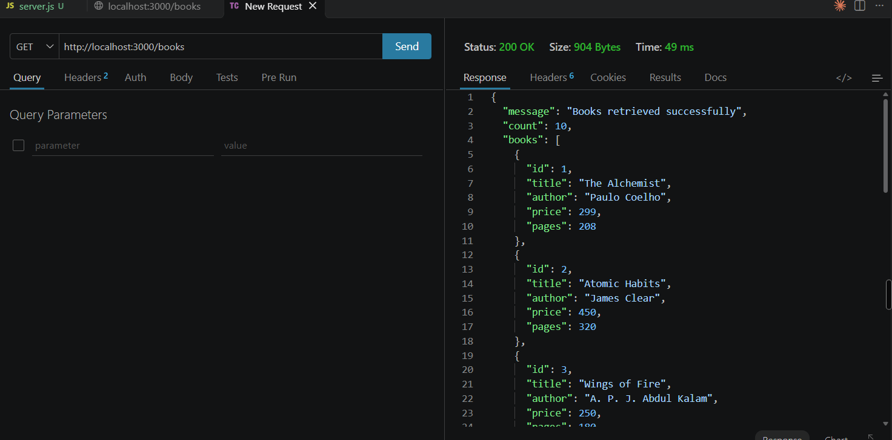

### 10.2 Search books

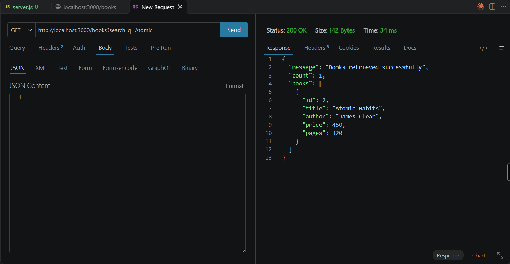

### 10.3 Sort books

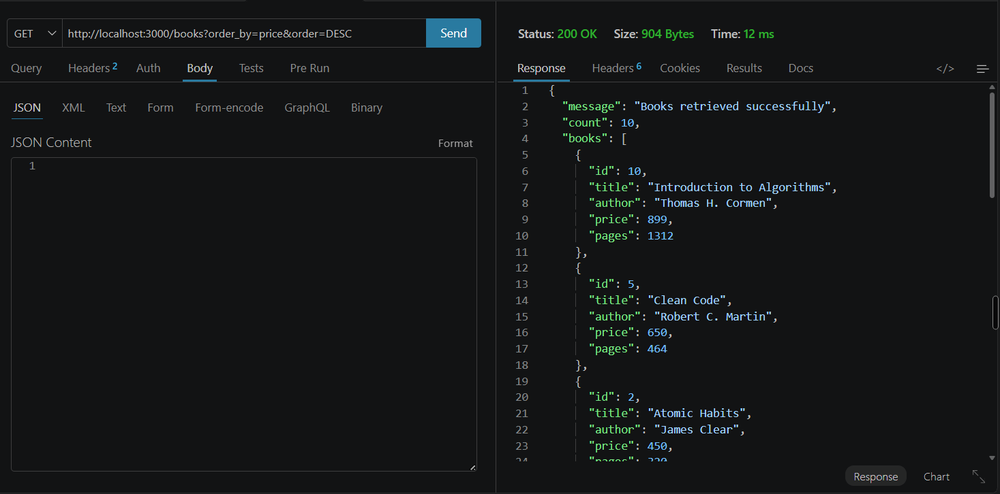

### 10.4 Pagination – first page

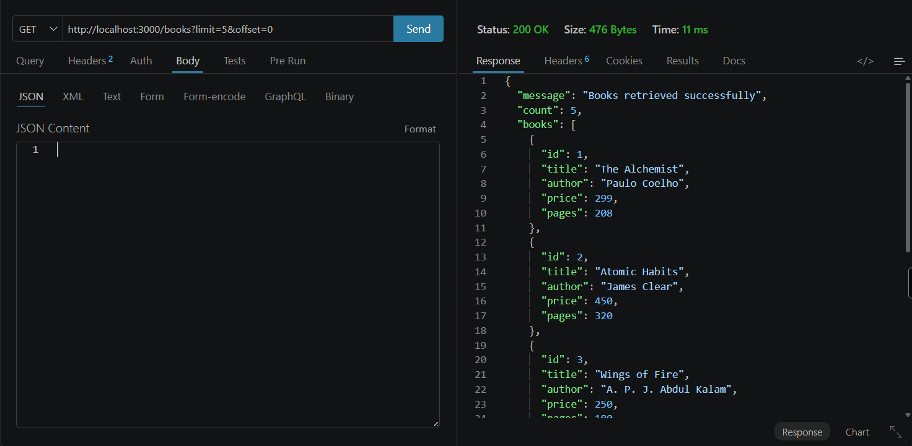

### 10.5 Pagination – second page

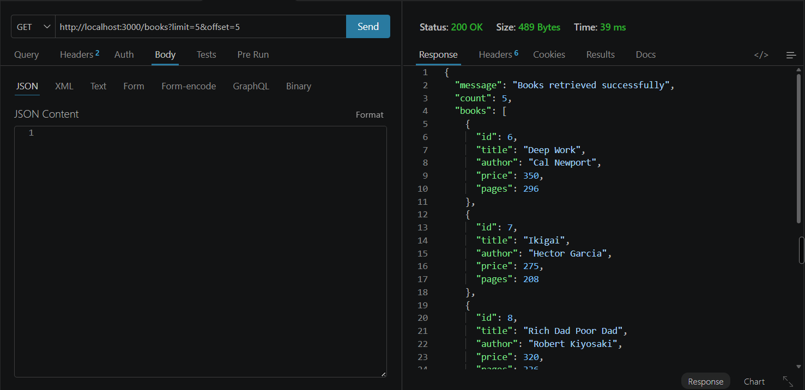

### 10.6 Price-range filter

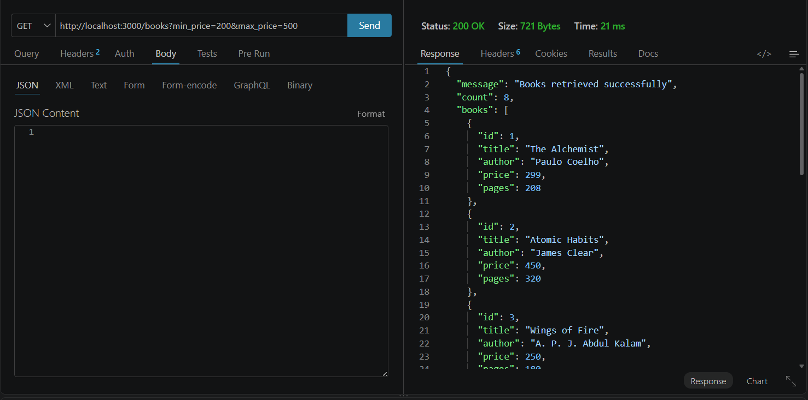

### 10.7 Validation – missing title

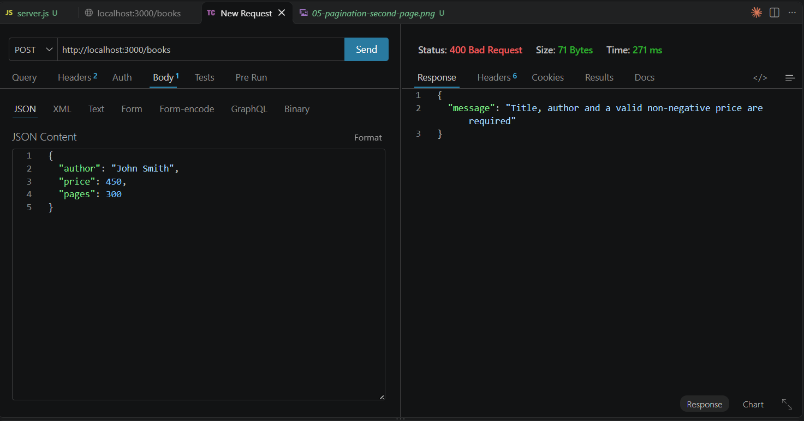

### 10.8 Validation – invalid price


### 10.9 Create book

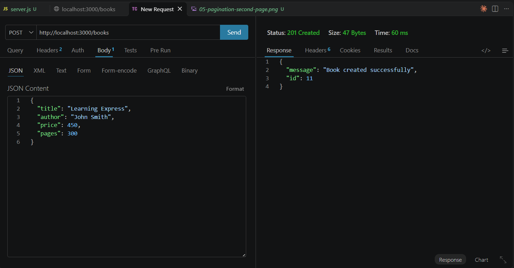

### 10.10 Update book

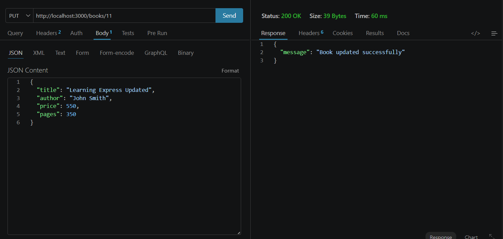

### 10.11 Delete book

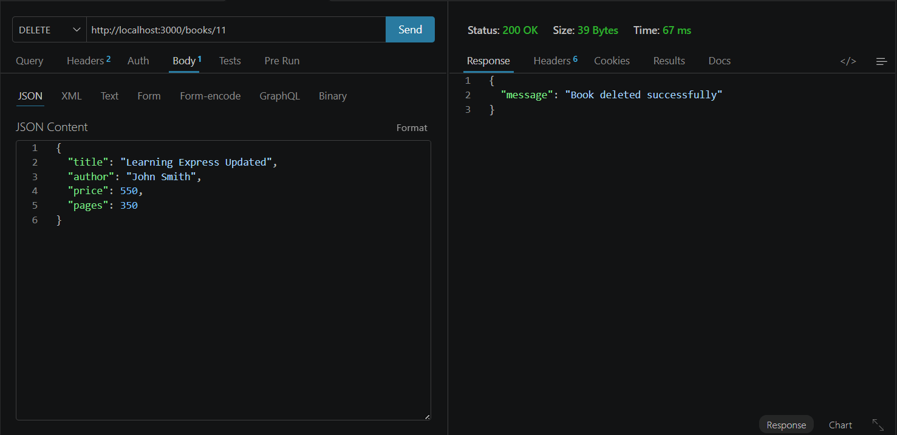

### 10.12 Book not found

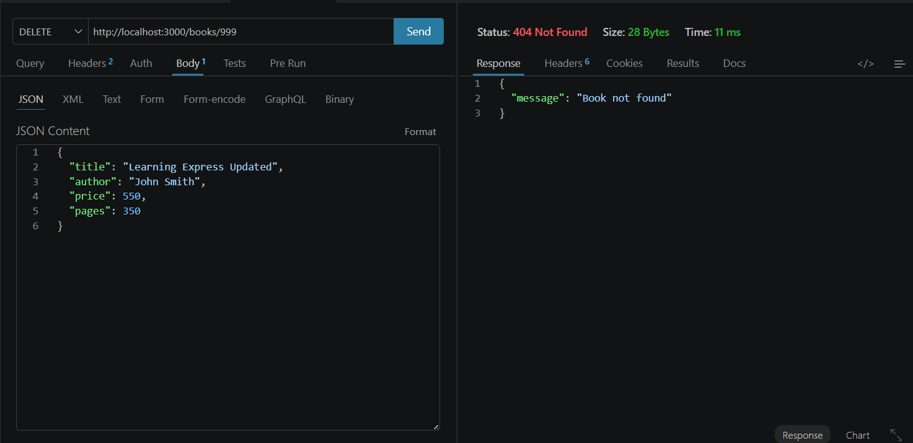

### 10.13 Invalid sorting

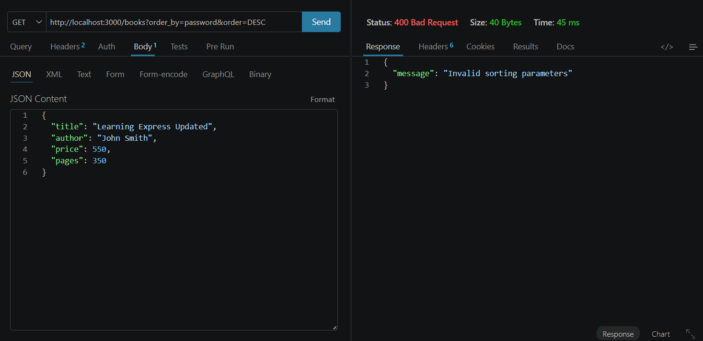

### 10.14 Invalid pagination

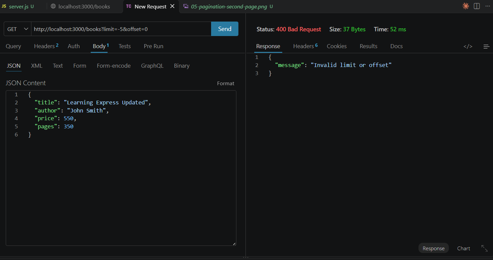

## 11. Debugging Problems and Solutions

| Problem | Meaning | Solution |
|---|---|---|
| `EADDRINUSE` | Another process is using the selected port. | Stop the other server or change `PORT`. |
| Wrong import path | Node.js cannot locate an imported file. | Check filename, spelling and relative path. |
| `no such table` | SQL refers to a table that does not exist. | Check the table name and database initialization. |
| Missing `await` | Code uses a Promise before the operation finishes. | Add `await` inside an `async` function. |
| PowerShell blocks npm | PowerShell blocks the `npm.ps1` script. | Use `npm.cmd install` and `npm.cmd start`. |

## 12. Viva Questions and Answers

**1. What is the difference between a query parameter and a path parameter?**

A path parameter identifies a particular resource, such as `/books/5`. A query parameter filters or changes the result, such as `/books?search_q=database`.

**2. What does stateless mean in REST?**

Each request contains the information needed to process it. The server does not depend on the previous request to understand the current request.

**3. Which status codes are used for bad input and a missing record?**

`400 Bad Request` is used for invalid input. `404 Not Found` is used when the requested record does not exist.

## 13. Security and Best Practices

- Use parameterized SQL queries to reduce SQL injection risks.
- Validate user input before saving it.
- Do not commit `.env` or secret values.
- Do not commit `node_modules/`.
- Return suitable HTTP status codes.
- Use meaningful Git commit messages.

## 14. Conclusion

In this lab, I developed a RESTful Books API using Node.js, Express.js and SQLite. I implemented GET, POST, PUT and DELETE operations. I also added search, sorting, pagination and price-range filtering using query parameters. Input validation and correct HTTP status codes help the API handle invalid requests and missing records. I tested the API using Thunder Client and documented the test cases with screenshots. This lab helped me understand REST API development, database operations, validation and debugging.


